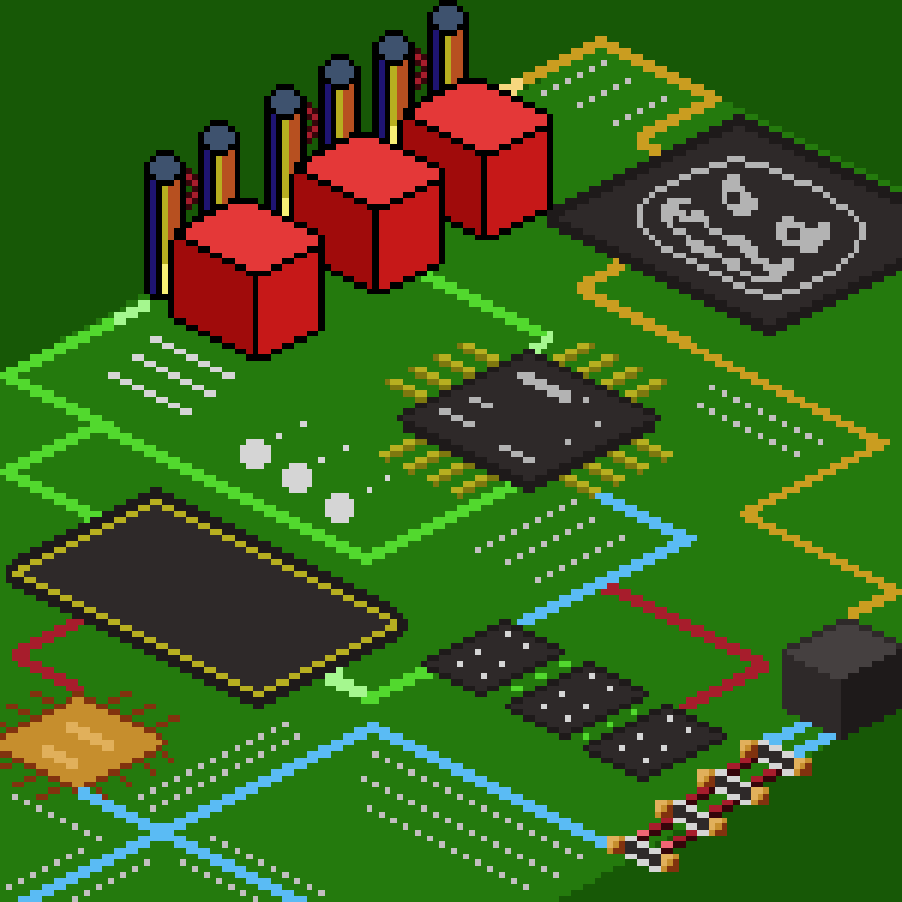

<!-- Header -->


<!-- Título e Saudação -->
<p align="center">
  
  <br/>
  
</p>

<!-- Contatos -->
<p align="center">
  <a href="mailto:adeniltonribeiro.r4@gmail.com"></a>
  <a href="https://www.linkedin.com/in/adenilton-ribeiro-92551b156"></a>
  <a href="https://www.instagram.com/adenilton_ribeiro4"></a>
</p>

<!-- Contadores -->
<p align="center">
  
  <a href="https://github.com/AdeniltonR?tab=followers"></a>
</p>


<!-- Sobre Mim -->
### `[ LEVEL 01 ]` ▸ PLAYER.C

```c
#include "embedded.h"
#include "hardware.h"

/* ============ PLAYER 1 SELECTED ============ */
typedef struct {
    const char *nome;
    const char *classe;
    const char *skills[4];
    const char *xp[4];
    const char *quests[2];
} player_t;

const player_t p1 = {
    .nome    = "Adenilton Ribeiro",
    .classe  = "Hardware & Firmware Engineer",
    .skills  = { "Eletronica", "Firmware",
                 "Linux Embarcado", "PCB + EMC" },
    .xp      = { "Pos em Seguranca Cibernetica",
                 "Engenharia Mecatronica",
                 "Tec. Automacao Industrial",
                 "Tec. Mecatronica" },
    .quests  = { "Linux Embarcado", "FPGA" },
};

int main(void) {
    hw_init();
    for (;;) build_reliable_systems();   /* no game over */
}
```

<!-- Status / Skills -->
### `[ LEVEL 02 ]` ▸ STATUS.SYS

```text
┌────────────────────────────────────────────────────┐
│  PLAYER: ADENILTON        CLASS: EMBEDDED ENGINEER │
├────────────────────────────────────────────────────┤
│  HARDWARE / PCB   [████████████████████]  MAX      │
│  FIRMWARE C/C++   [████████████████████]  MAX      │
│  MICROCONTROLLERS [██████████████████░░]           │
│  RTOS             [██████████████████░░]           │
│  LINUX EMBARCADO  [████████████████░░░░]  ▲ LVL UP │
│  FPGA             [████████░░░░░░░░░░░░]  ▲ LVL UP │
└────────────────────────────────────────────────────┘
```

<!-- Tecnologias e Ferramentas -->
### `[ LEVEL 03 ]` ▸ INVENTARIO.H

<table>
<tr>
<td width="24%"><b>🕹️ LINGUAGENS</b></td>
<td>
  
  
  
  
</td>
</tr>
<tr>
<td><b>⏱️ BARE-METAL & RTOS</b></td>
<td>
  
  
  
  
</td>
</tr>
<tr>
<td><b>🔌 MICROCONTROLADORES</b></td>
<td>
  
  
  
  
  
  
  
  
  
  
</td>
</tr>
<tr>
<td><b>🖥️ SBCs</b></td>
<td>
  
  
  
</td>
</tr>
<tr>
<td><b>🧰 IDEs & SDKs</b></td>
<td>
  
  
  
  
  
  
  
  
  
  
</td>
</tr>
<tr>
<td><b>📐 HARDWARE / PCB</b></td>
<td>
  
  
  
  
  
</td>
</tr>
</table>

<!-- GitHub Stats -->
### `[ LEVEL 04 ]` ▸ HIGH_SCORE.LOG

<div align="center">
<table>
  <tr>
    <td valign="top">
      
      <br/>
      
      <br/>
      
    </td>
    <td valign="middle" align="center">
      
    </td>
  </tr>
</table>
</div>

<!-- Activity Graph -->
<div align="center">
  
</div>

<!-- Rodapé -->


<p align="center">
  
</p>


